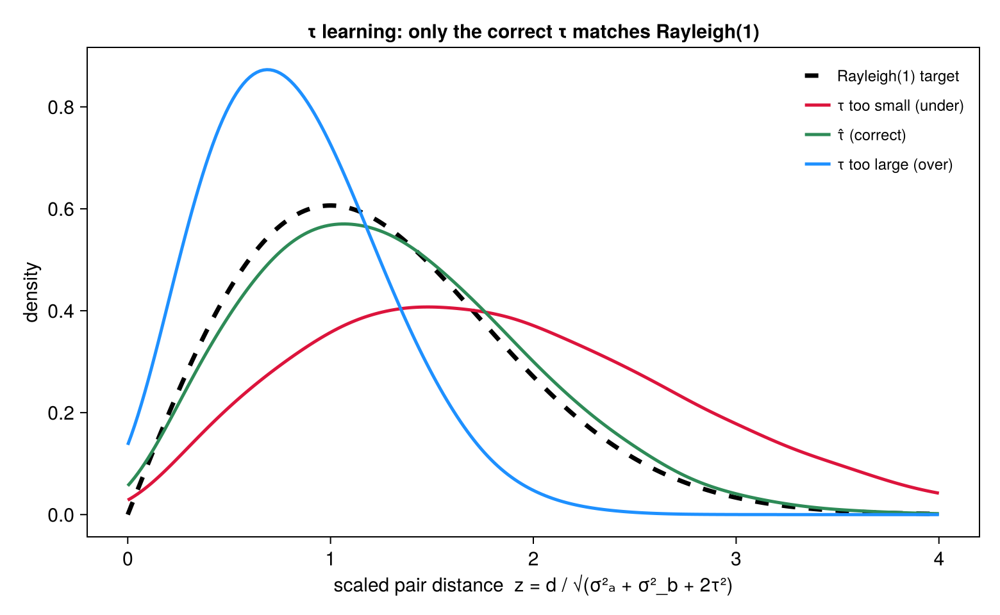
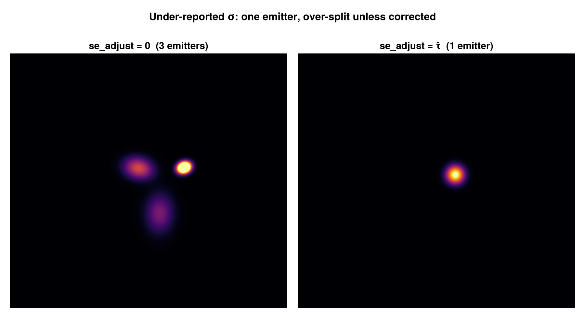

```@meta
CurrentModule = SMLMBaGoL
```

# Uncertainty Correction

BaGoL's accuracy rests on the reported localization uncertainties ``\sigma`` being correct.
When they are underestimated by a common amount ``\tau``, within-emitter localizations look
*too* spread out for their error bars, and BaGoL over-splits — one true emitter becomes
several. [`estimate_se_adjust`](@ref) recovers ``\tau`` from the data and
[`apply_se_adjust`](@ref) folds it in (`se_estimate.jl`).

## The Rayleigh statistic

At the true ``\tau`` and the correct grouping, the **scaled** separations of within-emitter
localization pairs follow a Rayleigh(1) law. For a within-group pair with separation ``d``,

```math
z = \frac{d}{\sqrt{\sigma_a^2 + \sigma_b^2 + 2\tau^2}} \;\sim\; \mathrm{Rayleigh}(1),
\qquad F(z) = 1 - e^{-z^2/2}.
```

The finder estimates ``\tau`` by minimizing the **Kolmogorov–Smirnov** distance between the
empirical CDF of the ``z`` and this reference:

```math
\hat{\tau} = \arg\min_{\tau}\ \max_i \left| \frac{i}{n} - \big(1 - e^{-z_{(i)}^2/2}\big) \right|.
```



*The distribution of scaled within-emitter pair distances ``z`` at three values of ``\tau``:
too small (``\tau = 0``, shifted right — localizations look over-spread), correct
(``\hat\tau``, matching the Rayleigh(1) target), and too large (shifted left — over-merged).
The estimator picks the ``\tau`` whose empirical distribution best matches Rayleigh(1), via
the Kolmogorov–Smirnov criterion above.*

## Self-consistent root search

Grouping depends on ``\tau`` and ``\tau`` depends on the grouping, so the estimate is the
self-consistent value ``\tau^*`` with ``m(\tau^*) = \tau^*``, where ``m(g)`` is built from
two steps:

1. **E-step** — regroup the data with a temporary BaGoL run at ``g`` (using BaGoL's own
   Dahl-consensus labels);
2. **M-step** — find the KS-minimizing ``\tau`` on that frozen grouping (right-biased, to
   preserve same-emitter spread; interpolating the threshold crossing between grid points
   removes grid quantization). Grouping changes and E-step noise mean ``m(g)`` is still
   only approximately continuous.

The initial M-step grid is `grid_um=0.0:0.0001:0.014` (0–14 nm). When its top
qualifies under the right-biased KS rule, the grid extends at its own last step,
reusing KS values and doubling its top up to `tau_max_um=0.05` (50 nm). This
changes no statistic: it evaluates the same continuous right-biased KS rule over
the range the data need. The cap is numerical, not a prior; it must be at least
the initial grid top, and the grid must contain at least two points. Later
E-steps reuse the extended grid, and their neighbor graph grows when needed.

The finder starts over-merged (clamping the start into
`(minimum(grid_um), tau_max_um)`) and searches for
the root of ``r(g) = m(g) - g`` with secant steps and a sign-change bracket (Illinois
regula falsi). The search stops when the root is bracketed within 2·stop_tol_um;
τ̂ interpolates inside that bracket. More precisely, `converged=true` requires either
an exact ``r = 0`` or measured endpoints ``r(a) > 0 > r(b)`` with
``b - a \le 2\,\mathtt{stop\_tol\_um}``. Each bracketed proposal stays at least
`stop_tol_um` from either end, with bisection as a fallback. The returned ``\hat\tau``
is the linear-interpolation root inside the final bracket, so for a root ``g^*`` inside
it, ``|\hat\tau - g^*| \le b - a \le 2\,\mathtt{stop\_tol\_um}`` on a width stop.
The result reports this bracket as `bracket_um`, or `(NaN, NaN)` without one (including
an exact root found before bracketing).

If an M-step's top still qualifies at the cap, the search stops with
`censored=true` and `converged=false` and emits a warning: the grouping prefers
τ above the cap, which can indicate over-merging or a model mismatch. The
returned `tau_hat_um` is then the cap, a lower bound rather than a root. The result
also reports `grid_top_um` (the final M-step grid top) and `tau_max_um`;
diagnostic `grid_nm` and `ks_path` use that final grid.

The bracket guarantees a sign change of the **measured** residual, not continuity or
uniqueness of a root. Start independence is measured behavior on genmab fields and
sr-signaling, not a theorem. A spatial-block bootstrap on the grouping nearest
``\hat\tau`` provides a 95% confidence interval (conditional on that grouping).
The bootstrap uses the same extending M-step and cap independently in each replicate;
`n_boot_censored` counts replicates censored at that cap. The estimator is
**isotropic**: it uses one per-localization uncertainty (the reported
``\sigma_x``) and a single scalar ``\tau``, so it is intended for data with roughly
isotropic localization precision.

## Applying the correction

[`apply_se_adjust`](@ref) inflates each localization's uncertainty in quadrature, per axis:

```math
\sigma_x' = \sqrt{\sigma_x^2 + \tau_x^2}, \qquad \sigma_y' = \sqrt{\sigma_y^2 + \tau_y^2},
```

after which the corrected ``\sigma'`` propagates into every precision ``\Lambda_i`` of the
[collapsed representation](collapsed.md). Set `se_adjust=:auto` to run the finder and apply
its result, or pass a known number directly. `:auto` throws an `ErrorException`
before applying a censored result, since the cap is a lower bound that could
over-merge the field. Pass a numeric `se_adjust` (μm), or estimate τ on a subset
with `estimate_se_adjust`. Uncensored estimates are still applied when unconverged,
with a progress-line note. The correction
self-guards against double-applying: data already corrected upstream (metadata
`sigma_corrected = true`) is skipped, and the finder refuses to run on already-corrected data.



*A single emitter whose reported σ is underestimated. With `se_adjust=0` BaGoL over-splits it
into three spurious emitters (left); with the estimated ``\hat\tau`` folded in it recovers the
one true emitter (right) — the visible failure mode the correction removes.*
